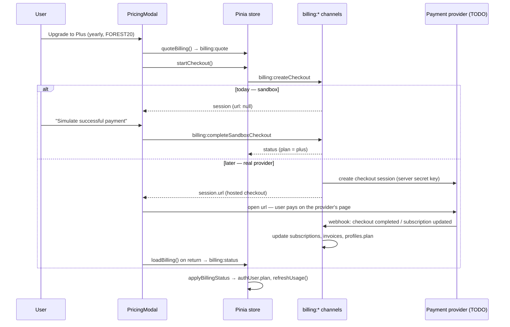

# Monetization — premium plans & ads

> **Status (2026-09-28): the client is built; the money isn't.**
> Everything a user *sees* exists: pricing page, checkout flow, plan badges,
> "Plan & billing" management, ad slots, upgrade nudges. What doesn't exist is
> anything that moves money, so no real payment provider and no ad network. A
> **sandbox** stands in for the payment provider so the whole flow can be
> clicked through in dev builds.
>
> Why it stops there: every payment provider and ad network asks for bank or
> card details, which the project's **zero-cost rule** forbids for now (see
> [`CLAUDE.md`](../CLAUDE.md), [`DEPLOYMENT_PLAN.md`](./DEPLOYMENT_PLAN.md)).
> This doc is the to-do list for when that rule is lifted.

**Jump to:** [What's built](#1-whats-built-today) ·
[How it fits together](#2-how-it-fits-together) ·
[The contract](#3-the-client--server-contract) ·
[Backend to-do (payments)](#4-backend-to-do--payments) ·
[Ads to-do](#5-ads-to-do) · [Legal to-do](#6-legal--tax-to-do) ·
[Testing](#7-testing-it-today)

---

## ✅ Before taking a single real payment (short version)

- [ ] Lift the zero-cost rule and pick a provider (§4.1). A *Merchant of Record* is recommended.
- [ ] Create the Plus/Pro products & prices in the provider, matching `PLAN_CATALOG` (§4.2)
- [ ] Server-side `billing:createCheckout` that returns the provider's hosted-checkout URL (§4.3)
- [ ] Webhook endpoint that verifies signatures and updates `subscriptions` / `invoices` / `profiles.plan` (§4.4)
- [ ] **Remove `billing:completeSandboxCheckout` from any hosted backend** (§4.6)
- [ ] Customer portal for card changes, receipts and cancellation (§4.5)
- [ ] Terms of Service: subscription terms, auto-renewal, EU/Norway withdrawal rules; update the Privacy Policy (§6)
- [ ] VAT-inclusive prices for EU/EEA consumers (§6)
- [ ] Test the full path in the provider's *test mode* before going live

---

## 1. What's built today

| Piece | Where | Notes |
|---|---|---|
| Plan catalog: prices, perks, "coming soon" flags | `src/shared/billing.ts` → `PLAN_CATALOG`, `PERKS` | Free · **Plus** $4/mo or $36/yr · **Pro** $9/mo or $81/yr (USD). Perks with `live: false` are shown as "Soon" and never sold as if they exist. |
| Plan limits | `src/shared/auth.ts` → `PLAN_LIMITS` | free 10/2,500/300 · plus 50/25k/5k · pro 500/250k/50k (projects/people/photos). Mirrored in `supabase/schema.sql` → `plan_limits`. |
| Plan features (caps switchboard) | `PLAN_FEATURES` in `auth.ts` | Paid tiers are `['*']`: a superset of free, so paying never removes a feature. Nothing is paid-exclusive yet. |
| Plan perks (ads, badge) | `planHasPerk()` in `billing.ts` | `adFree` is a perk, **not** a caps flag. Free keeps `'*'` caps, so caps can't express "free has ads". |
| Price quotes + promo codes | `quote()` / `billing:quote` | Sandbox codes: `FOREST20` (−20%), `EARLYBIRD` (−50%, yearly only), `GRAFT10` (−10%). |
| Subscription / checkout / invoice records | `db.billing` (created lazily) | Shapes: `Subscription`, `CheckoutSession`, `Invoice` in `billing.ts`. |
| `billing:*` channels | `billingHandlers` in `billing.ts`, merged in `dbCore.ts` | Work on desktop + web-local. **Not** implemented in `supabase.ts`: they return "not implemented", and the UI degrades to "Payments open soon". |
| Sandbox switch | `Env.billingSandbox` | Web: on in `npm run dev:web` or with `VITE_BILLING_SANDBOX=1`. Desktop: on when unpackaged or with `BILLING_SANDBOX=1`. **Off in production builds**: checkout refuses with "Payments aren't live yet". |
| Pricing & checkout dialog | `components/billing/PricingModal.vue` | Steps: plans → review (promo code, totals, renewal date, terms checkbox) → payment partner (sandbox stand-in) → welcome / declined. With payments off, "Continue" becomes "Notify me", which only saves a flag on the device. |
| Plan badge | `components/billing/PlanBadge.vue` | Account menu, pricing cards, billing panel. |
| Plan & billing panel | `components/billing/BillingPanel.vue` (on `UserPage.vue`) | Current plan, renews/ends date, Change plan, Cancel (keeps the plan to period end) / Keep my plan, invoice history. |
| Upgrade entry points | `App.vue` topbar **✦ Go Plus** pill, `AccountMenu.vue` upsell card + "Plan & billing", `paid/index.ts` refusal screen "See plans" | Free accounts only. Guests are told to create an account first. |
| Quota nudges | `onPlanLimit()` in `api/index.ts` → toast in `App.vue` | Any channel refusing with "…plan limit reached…" offers **See plans** (throttled to one toast per 8 s). |
| Ad slots | `components/billing/AdSlot.vue` + `lib/ads.ts` | Placements: Browse (a card in the grid after the 6th tree, plus a banner between shelves) and the Projects page (a slim strip). House ads only (self-promotion). Hidden for paid plans; each ad can be dismissed for the session. |
| Store | `store/index.js` | `pricingOpen`, `openPricing(ctx)`, `loadBilling`, `quoteBilling`, `startCheckout`, `completeSandboxCheckout`, `cancelSubscription`, `resumeSubscription`, `adFree`, `isPaid`. |
| Tests | `tests/billing.test.js` (+ the plan-features test in `tests/auth.test.js`) | Catalog sanity, quotes, the sandbox lifecycle, cancel → revert, refusal cases. |
| i18n | `billing.*`, `ads.*` in all three locales | |

### Placement policy (keep this when adding ads)

- Ads go on **discovery surfaces only** (Browse, Projects library), **never inside the editor views** (graph, timeline, map…). The editor is the product; don't tax it.
- **Never for paid plans.** `AdSlot` checks `store.adFree` itself, so a placement can't forget.
- Always labelled **"Ad"**, always with a **Remove ads** link and a **dismiss ✕**.
- Gate scale, privacy, permanence and pro output, never the first delightful hour (see [`WILD_IDEAS.md`](./WILD_IDEAS.md) → "Free-tier gravity").

---

## 2. How it fits together

The **server owns the plan**. The renderer never sets `authUser.plan` from its
own belief; it adopts whatever `billing:status` / `auth:session` report
(`applyBillingStatus`). Quotas are enforced server-side from `user.plan`
(`limitsFor()`, and the `plan_limits` triggers on Supabase).

---

## 3. The client ↔ server contract

These channels are what the hosted backend must implement. Keep payloads and
return shapes identical so the UI doesn't change.

| Channel | Payload | Returns | Notes for the real backend |
|---|---|---|---|
| `billing:catalog` | — | `{ plans, limits, perks, provider: 'sandbox' \| 'none' }` | Add `'stripe'` / `'paddle'` / `'lemonsqueezy'` as the provider value. The UI only branches on `sandbox` vs not. |
| `billing:status` | — | `{ plan, subscription \| null, invoices[] }` | Read from DB rows kept in sync by webhooks. May settle a lapsed subscription (write). |
| `billing:quote` | `{ plan, interval, coupon? }` | `Quote` | Validate promo codes **at the provider**, never from a client-side list. |
| `billing:createCheckout` | `{ plan, interval, coupon? }` | `CheckoutSession` (`url` = hosted checkout) | Guests are refused. Uses the provider's **secret key**, so it must run server-side (Supabase Edge Function). |
| `billing:completeSandboxCheckout` | `{ id, outcome: 'success' \| 'fail' \| 'cancel' }` | `{ session, status }` | **SANDBOX ONLY.** Must not exist on a hosted backend. |
| `billing:cancel` | — | status | Real: tell the provider `cancel_at_period_end`. Or delegate to the portal. |
| `billing:resume` | — | status | Real: undo the scheduled cancellation at the provider. |
| *(new)* `billing:portal` | — | `{ url }` | Provider customer-portal link (update card, download receipts). Add a "Manage payment method" button to `BillingPanel.vue`. |

All of them sit behind a session (not in `PUBLIC_CHANNELS`). The mutating ones
are in `BILLING_WRITE_CHANNELS`.

---

## 4. Backend to-do — payments

### 4.1 🧑 YOU — Pick a provider (needs bank details → lifts the zero-cost rule)

| Option | Pros | Cons |
|---|---|---|
| **Lemon Squeezy** or **Paddle** (*Merchant of Record*) | They are the legal seller: they collect and remit **VAT/GST worldwide** (EU, UK, Norway…), issue compliant receipts, and handle chargebacks. Simplest for a solo developer in Norway. | Higher fee (≈5% + fixed). Less control over the checkout page. |
| **Stripe** (Checkout + Billing) | Lowest fees, best API, great test mode. | **You** are the seller: VAT registration and filing are yours (Stripe Tax is paid). More legal work. |

**Recommendation:** start with a Merchant of Record. The UI already assumes a
hosted checkout, so card details never touch our app, which also keeps PCI
scope at zero.

### 4.2 🧑 YOU — Create products & prices

Create **Plus** and **Pro**, each with a monthly and a yearly price, matching
`PLAN_CATALOG` (cents). Then add the provider's price IDs next to the catalog,
e.g. a `providerPriceId: { month, year }` field on `PlanOffer`. That field is
read server-side only. Recreate the promo codes there (`FOREST20`, `EARLYBIRD`
yearly-only, `GRAFT10`) and delete `SANDBOX_COUPONS`.

### 4.3 🤖 CLAUDE — Server-side checkout

> **Prompt:** "Implement `billing:createCheckout` for the hosted backend as a
> Supabase Edge Function using the provider's API (secret key from function
> secrets, never shipped to the browser). Map `{ plan, interval, coupon }` to the
> provider price ID, attach the Supabase user id as metadata/`client_reference_id`,
> set success/cancel return URLs, and return the `CheckoutSession` shape from
> `src/shared/billing.ts` with `url` filled in. Route it from `supabase.ts`."

Renderer side, once `url` is non-null:
- **Web:** `window.location.assign(url)`. On return (`?checkout=success`), call `store.loadBilling()` and open the welcome step.
- **Desktop (Electron):** open it with `shell.openExternal(url)` through a **new explicit preload/IPC channel** (keep the sandbox: no widening of renderer privileges). Return via a custom-protocol deep link (`familytree://billing/return`) or by polling `billing:status` while the dialog waits.
- Replace the sandbox "payment partner" step in `PricingModal.vue` with a "Waiting for payment…" state.

### 4.4 🤖 CLAUDE — Webhooks (the only thing that changes a plan)

> **Prompt:** "Add a Supabase Edge Function `billing-webhook` that verifies the
> provider's webhook signature, records each event id in a `billing_events`
> table for idempotency, and on checkout completed / subscription
> created·updated·deleted / invoice paid·failed upserts `subscriptions` and
> `invoices` rows (shapes from `src/shared/billing.ts`) and sets
> `profiles.plan` with the service role. Add those tables with RLS: users can
> *select* their own rows, nobody can write from the client."

- Plan changes happen **only here**. `supabase/schema.sql` already blocks `authenticated`/`anon` from changing `profiles.plan` (the `profiles_guard_plan` trigger), and `plan_limits` already has `plus`/`pro` rows.
- Downgrades: when a subscription ends, set `plan = 'free'`. **Never delete data** over quota. Only block *adding* (that's what the insert triggers do).
- Failed renewals: decide the grace period (e.g. 7 days `past_due` before revert). Add a `'past_due'` status to `SubscriptionStatus` and show a banner in `BillingPanel`.

### 4.5 🤖 CLAUDE — Customer portal

Add `billing:portal` → provider portal URL. Add a "Manage payment method &
receipts" button in `BillingPanel.vue`. Keep the in-app Cancel / Keep buttons
(calling the provider API), or send users to the portal for everything.

### 4.6 🤖 CLAUDE — Remove the sandbox from production

- `billingSandbox` is already false in production builds. Keep it that way. Add a CI check that `VITE_BILLING_SANDBOX` isn't set for the production web build.
- The hosted backend must **not** implement `billing:completeSandboxCheckout`, and `SANDBOX_COUPONS` should be gone.
- `settleSubscription()`'s auto-renew/lapse logic is sandbox-only too; on the server, webhooks do this.

### 4.7 Later

- **Proration** when switching Plus ↔ Pro mid-period (the sandbox just restarts the period; real providers prorate).
- **Local currencies** (NOK/EUR/GBP price lists at the provider). `PricingModal` already formats with `Intl` from the quote's `currency`.
- **Team / education plans** ([`WILD_IDEAS.md`](./WILD_IDEAS.md) P10), **one-time purchases** (style packs P4, print P2), **AI credits** (P5): each is a new `PlanOffer`-like catalog entry plus webhook handling.
- **Mobile stores** (Phase 6 of the deployment plan): Apple and Google require **in-app purchase** for digital subscriptions bought inside a store app. Plan for a store-billing adapter feeding the same `subscriptions` table.
- **Desktop entitlements:** the desktop app stores data locally, so premium there needs an online entitlement check (sign in with the hosted account) or a license key.

---

## 5. Ads to-do

Today: **house ads only** (`HOUSE_ADS` in `lib/ads.ts`). They advertise our own
plans and the Browse page: no third-party script, no tracking, no consent
banner needed.

- [ ] **Decide what "real" ads means.** Options, best-fit first:
  1. **Direct sponsorships / verified franchise trees** ([`WILD_IDEAS.md`](./WILD_IDEAS.md) P7). No network, no tracking; sold as a `sponsor` creative through the same `AdProvider`.
  2. **Privacy-friendly contextual networks** (EthicalAds, Carbon). No tracking cookies, so usually no consent banner. They need an account and payout details.
  3. **Programmatic networks** (Google AdSense etc.). Highest fill, but personalized ads in the **EEA (Norway included)** need a **certified consent platform (IAB TCF v2.2)**, extra privacy-policy work, and carry the "ads next to real-family data" risk flagged in `WILD_IDEAS.md`. Avoid unless needed.
- [ ] Implement an `AdProvider` for the chosen source (`pick()` returns an `AdCreative` with raw `text` instead of `copyKey`; `track()` forwards impressions/clicks) and register it with `setAdProvider()` at startup, **web build only**. Keep house ads on desktop.
- [ ] **CSP:** the web build's Content-Security-Policy must allow the network's script/image/frame domains. Electron's tight CSP stays as it is (no network ads on desktop).
- [ ] **Consent:** if anything sets cookies or tracks, show a consent banner *before* loading it, and let `AdSlot` fall back to house ads when consent is refused.
- [ ] **Ad blockers:** `AdSlot` already renders nothing when `pick()` returns null, so there's nothing to break.
- [ ] **Measurement:** send `adEventLog` events (impression/click/dismiss) to the analytics tool of choice. Server-side frequency caps if the network doesn't provide them.
- [ ] Never target or personalize on **tree contents** (real people's data). Contextual placement only.

---

## 6. Legal & tax to-do

(Not legal advice. Have the final texts checked.)

- [ ] **Terms of Service** (`LegalModal.vue`): plan descriptions, price changes, **auto-renewal disclosure** (the checkout checkbox already says it), cancellation (effective at period end), refunds, what happens to data on downgrade (kept, read-only over quota).
- [ ] **EU / Norway right of withdrawal** (angrerettloven / Consumer Rights Directive): consumers get 14 days to withdraw from online contracts. For immediate digital service access you need their **explicit consent to start now** and their **acknowledgement that they lose the right** once the service is delivered. Add that wording to the checkout checkbox.
- [ ] **Show VAT-inclusive prices** to EU/EEA consumers (legally required). Get the tax-inclusive price from the provider in `billing:quote` and change the "Taxes may apply" fine print.
- [ ] **Privacy Policy:** name the payment provider (and any ad network) as sub-processors, list what billing data is kept (no card data), and the retention period for invoices (Norway's bookkeeping act: 5 years).
- [ ] Receipts/invoices with seller details and VAT (the Merchant of Record does this for you).

---

## 7. Testing it today

- **Automated:** `npx vitest run tests/billing.test.js`
- **By hand (web):** `npm run dev:web` → **register an account** (guests can't buy) → **✦ Go Plus** in the topbar → pick a plan → try `EARLYBIRD` on monthly (rejected: yearly only) and `FOREST20` → Continue → **Simulate successful payment** / **Simulate declined card**. Check: badge changes, ads disappear from Browse/Projects, quotas rise (account menu), **My profile → Plan & billing** shows the invoice, and **Cancel plan** shows "ends … — won't renew".
- **Payments-off path:** a production build (`npm run build:web && npm run preview:web`) shows "Payments open soon", and Continue becomes **Notify me**.
- **Desktop:** `npm run dev` (unpackaged, so the sandbox is on).
