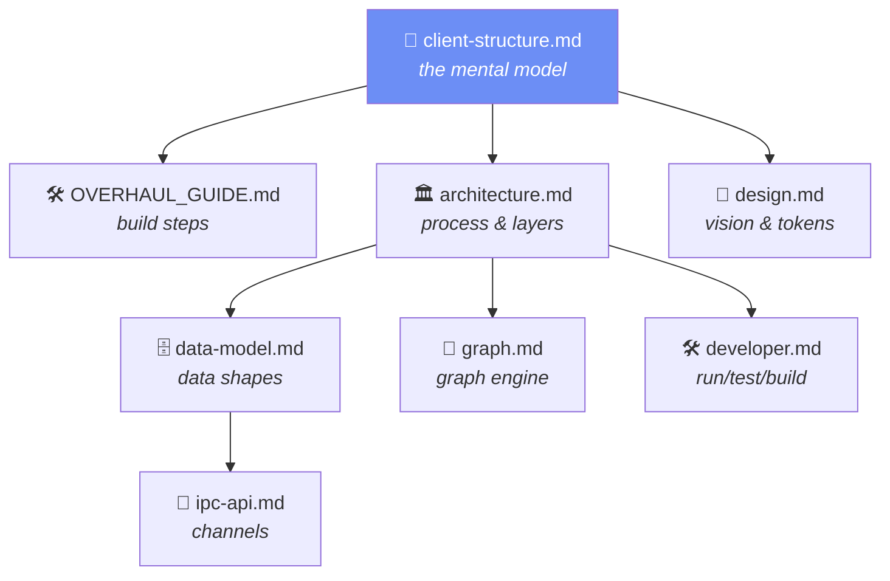

# FamilyTree documentation

Developer and design documentation for the FamilyTree desktop app. If you're new
here, read them roughly in this order:

| Doc | What it covers |
|-----|----------------|
| [client-structure.md](./client-structure.md) | **Visual guide** to projects, views, layout types, scenes, tags/groups & state. Read this first for the mental model. |
| [OVERHAUL_GUIDE.md](./OVERHAUL_GUIDE.md) | The (completed) step-by-step build plan the client overhaul followed — kept as a record. |
| [architecture.md](./architecture.md) | Process model, layers, data flow, module map. |
| [data-model.md](./data-model.md) | The JSON store shape, entities, IDs, migrations. |
| [ipc-api.md](./ipc-api.md) | Every IPC channel, the request/response envelope, and the preload bridge. |
| [graph.md](./graph.md) | The graph engine — layout types, scenes, guides, Focus filters, persistence. |
| [conventions.md](./conventions.md) | Coding conventions and the patterns to follow. |
| [developer.md](./developer.md) | Setup, scripts, project layout, testing, build internals. |
| [contributing.md](./contributing.md) | Branch/PR workflow and the definition of done. |
| [design.md](./design.md) | Product vision, UX principles, the visual design system, roadmap. |
| [PROMPT_GUIDE.md](./PROMPT_GUIDE.md) | How to prompt AI agents on this project — design & coding vocabulary banks, the ambition dial, project rules to mention, words that backfire, copy-paste templates. |
| [NOT_IMPLEMENTED.md](./NOT_IMPLEMENTED.md) | **The consolidated backlog** — every planned/proposed item across all docs that isn't built yet (or is only partly built), verified against the code, with status, effort, blockers and implementation notes. |
| [WILD_IDEAS.md](./WILD_IDEAS.md) | Blue-sky brainstorm — future & wild ideas, status of what's captured, new concepts to grow into, and profitability bets by audience/ROI/risk. |
| [MONETIZATION.md](./MONETIZATION.md) | Premium plans & ads — what's built on the client (pricing, sandbox checkout, billing panel, ad slots), the `billing:*` contract, and the backend/ads/legal to-do list for taking real payments. |
| [CODE_PROTECTION_PLAN.md](./CODE_PROTECTION_PLAN.md) | Anti-theft plan for the deployed website — server-side enforcement, paid-feature chunk gating, obfuscation, legal footing, and what to do before vs. after deploy. |

### How the docs fit together

For a user-facing overview and quick start, see the [project README](../README.md).
